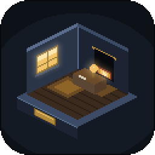

# Diorama Detective Demo

Early technical demo of **Diorama Detective**, a detective game set in small pixel-art dioramas. Turn the diorama, look into every corner and piece together what happened.

This repository only hosts the demo builds. The game itself is in development.

**Play in your browser: https://comicsans.github.io/diorama-detective-demo/** (desktop browser, no download).

## What is in this demo (version 0.5)

- You start on the street in front of Mr Marrow's shop. A note from Mrs Pell lies on the doorstep; the door stays shut in the demo ("The shop opens in the full game"). In the shop window stands one diorama box: click it to step in.
- The demo level, *The Last Telegram*: a small railway station and its telegraph office, 1893, at night in light rain. A station master lies dead in his office. One dead man, three living ones and a train that has not yet arrived.
- One explorable diorama with free camera controls: turn it without limits, zoom smoothly, move the view. Zoom and movement are limited so the diorama always stays in view.
- Click any object to examine it. Hover shows its title; hold **Space** (or use **Show all**) to see every clickable object. A few small details carry no clue at all.
- Highlighted words in the texts are clues: click each one to collect it (37 words in this case). The word bank at the bottom collects them (**Tab** or a click on the strip opens it). Two clues are hidden and only visible from the right angle.
- The **case book** (button **Case book** or key **C**) is a book: contents on the left, the riddle page on the right, turn pages with the arrows (**Q** / **E** or the shoulder buttons). Assign the names to the people, then fill in the gaps of the story. Put a word into a gap by dragging it there, or click a gap and then click the word. Click a filled gap to clear it; drag a word from one gap to another to move it. Gaps show which kind of word they want (symbol and colour). A word can be used in several gaps.
- Each group of gaps tells you how you are doing once all its gaps are filled: "Something is wrong", "Two or fewer incorrect" or "Correct". It never says which gap is wrong. The story pages belong to one group, so you hear back only when all of them are full.
- When every group is correct, the case is solved. **Step back** (Esc) returns you to the shop window; **Leave** ends the game.
- Your progress is saved automatically.
- Only this one case is included. The rest of the game is not part of the demo.

## Saves

Progress is stored per case in your user data folder (macOS: `~/Library/Application Support/DioramaDetective/saves/`, Windows: `%APPDATA%\DioramaDetective\saves\`, Linux: `~/.local/share/DioramaDetective/saves/`). To start over, delete `case_01.json` there, or start the game once with the argument `--reset-save`.

## Download

Get the latest build from the [Releases](../../releases) page:

| Platform | File |
|---|---|
| Windows (64-bit) | `DioramaDetective-0.5.0-windows.zip` |
| macOS (Apple Silicon and Intel) | `DioramaDetective-0.5.0-macos.zip` |
| Linux (x86_64) | `DioramaDetective-0.5.0-linux.zip` |
| Web (any modern desktop browser) | `DioramaDetective-0.5.0-web.zip` |

### System requirements

- macOS: Mac with Metal support (Apple Silicon and Intel).
- Windows and Linux: 64-bit, graphics card with Vulkan support.

### Web

The web build is a plain static site (no threads, WebGL 2): unzip it and put the files on any web server, then open `index.html` in a desktop browser. It does not run from a `file://` address; for a quick local try, start `python3 -m http.server` inside the folder. It plays like the desktop demo, but loads slower on weak graphics hardware.

### macOS

The app is signed and notarized by Apple. Unzip it, move **DioramaDetective.app** to your Applications folder if you like, and open it with a double click. On first start macOS asks once whether you want to open an app downloaded from the internet; confirm with **Open**.

### Windows

The build is not signed. If SmartScreen warns you, click **More info > Run anyway**.

### Linux

Unpack the archive and start `DioramaDetective.x86_64`. If it does not start, make it executable with `chmod +x DioramaDetective.x86_64`.

The Windows and Linux builds were exported but not yet tested on real Windows or Linux machines. Feedback is welcome.

## Controls

| Action | Mouse | Keyboard | Gamepad |
|---|---|---|---|
| Rotate the diorama | Drag with the left mouse button | Q / E | Right stick |
| Zoom | Mouse wheel, trackpad pinch or two-finger swipe | + / − | Shoulder buttons |
| Move the view | Drag with the right or middle mouse button | Arrow keys, WASD | Left stick |
| Examine an object | Left click | | |
| Show all clickable objects | Hold Space or use Show all | Space | |
| Word bank | Click the strip | Tab | |
| Case book | Case book button | C | |
| Close a window, step back from the diorama | | Esc | Start / B |

Zoom and movement are limited so the diorama always stays in view.

## Feedback

Found a bug or have an idea? Open an [issue](../../issues).

## License

The demo builds are free to download and play. All rights reserved; redistribution is not permitted.

Built with [Godot Engine](https://godotengine.org) (MIT license). The licenses of Godot and its third-party components are listed in the Godot Engine license page: https://godotengine.org/license
